# 量子围棋 / Quantum Go

一个围棋变体：**一手可以同时落在两个点上**，现实当场裂成两个权重各半的宇宙，
两边各落一颗子。每次分裂里，两颗新子**恰好一颗是虚子**——它可能根本不存在，
但双方都看不到是哪一颗。提掉它（或它参与提子）就是一次观测，它所在的那支
连同整棵子树一起消失，权重还给同一次分裂里真实的那一半。

最后按「各宇宙目数 × 权重」加权求和定胜负。

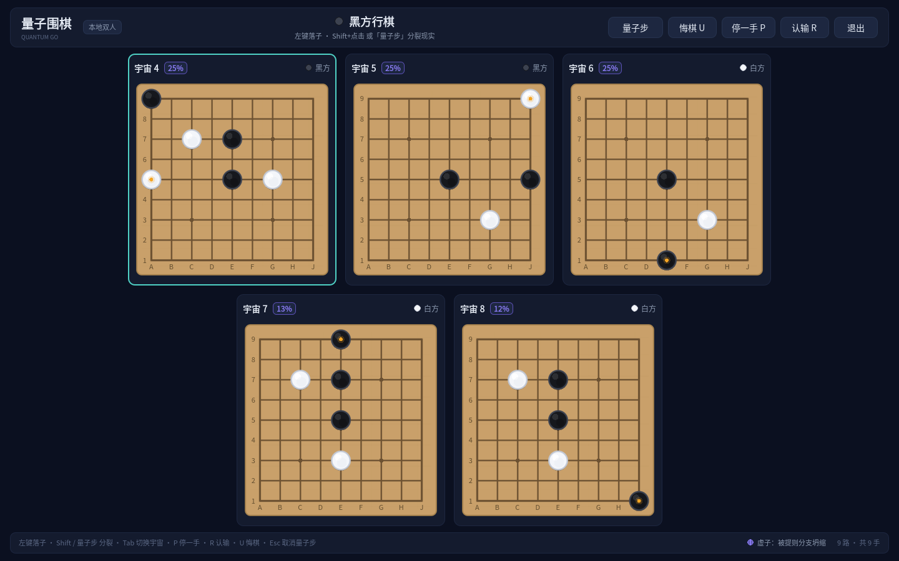

## 规则要点

- **量子步**：一次点两个空点。父宇宙退役，裂成两个平级宇宙，各占一半权重。
- **虚子**：每颗新子有 50% 是虚子，另一颗必为实子；哪边是哪边，双方都不知道。
  虚子沿分支继承，所以一个分支身上可能挂着 0～N 颗。
- **观测/坍缩**：虚子被提、或虚子所在的那一块参与提子时，它被判空——那支连同
  下面的所有分支一起消减，权重交给同一次分裂里真实的那一半。
- **结算**：双方在各自宇宙停手，全部封印后进入结算阶段：点掉死子、双方确认，
  按加权目数比大小。

对局中看不到虚子：

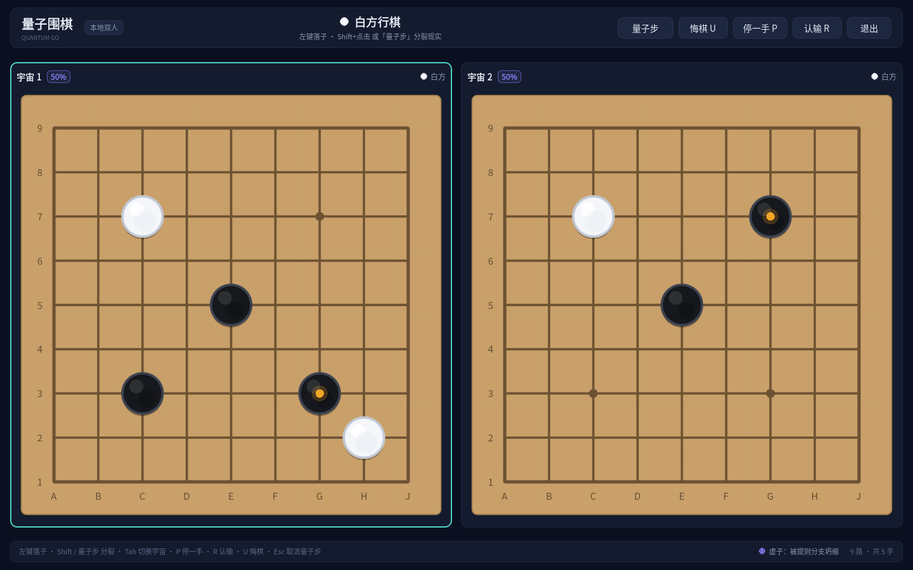

对局结束后可以逐步**复盘**，这时才标出当时的虚子，以及同一次分裂里与它对应的实子：

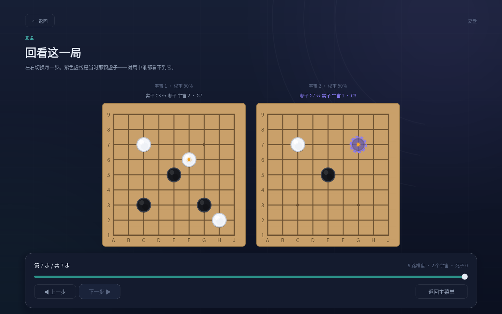

完整规则在 [`docs/RULES.md`](docs/RULES.md)，架构与接口契约在
[`docs/ARCHITECTURE.md`](docs/ARCHITECTURE.md)。

## 界面

| | |
|:--:|:--:|
| 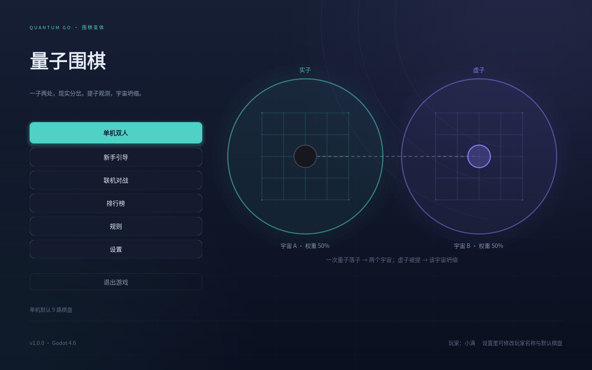<br>主菜单：一手棋，两个宇宙 | 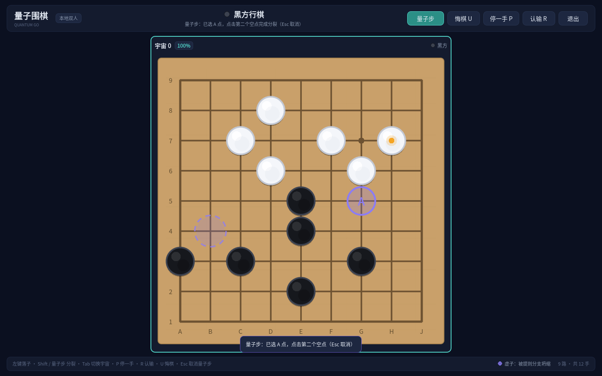<br>量子步：A 点已落下，紫色是 B 点候选 |
| 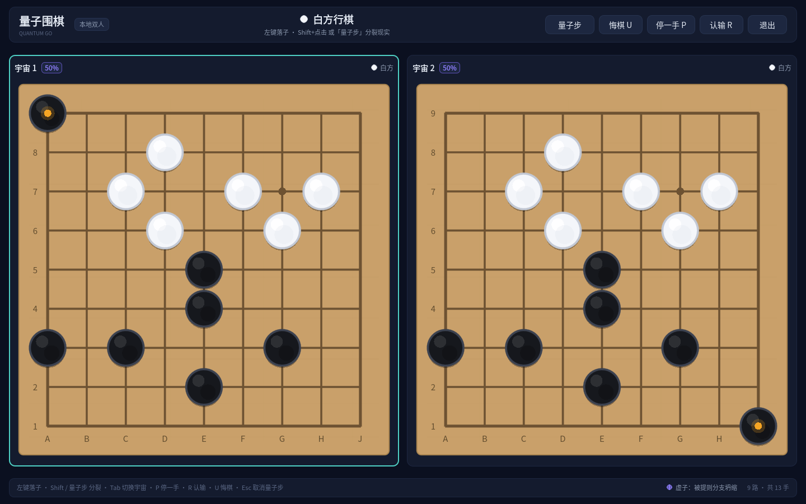<br>分裂后的两个宇宙，各 50% | 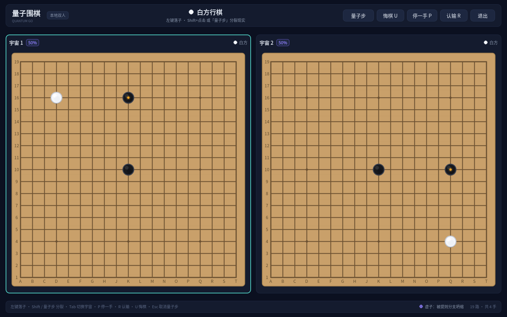<br>19 路棋盘 + 3 个宇宙的聚焦布局 |
| 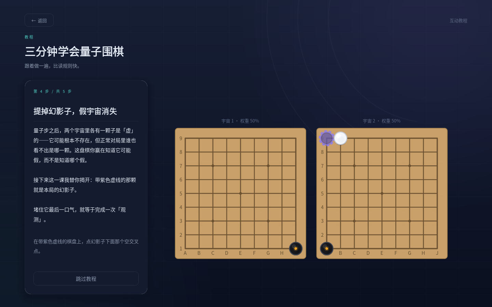<br>五步互动教程（这一课会揭开虚子） | 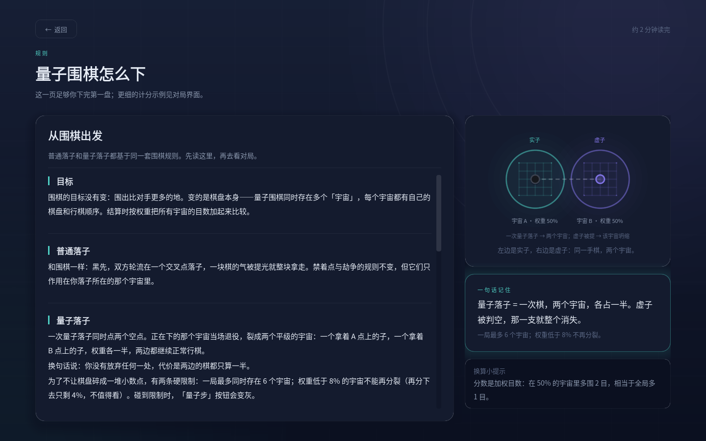<br>内置规则页，两分钟读完 |
| 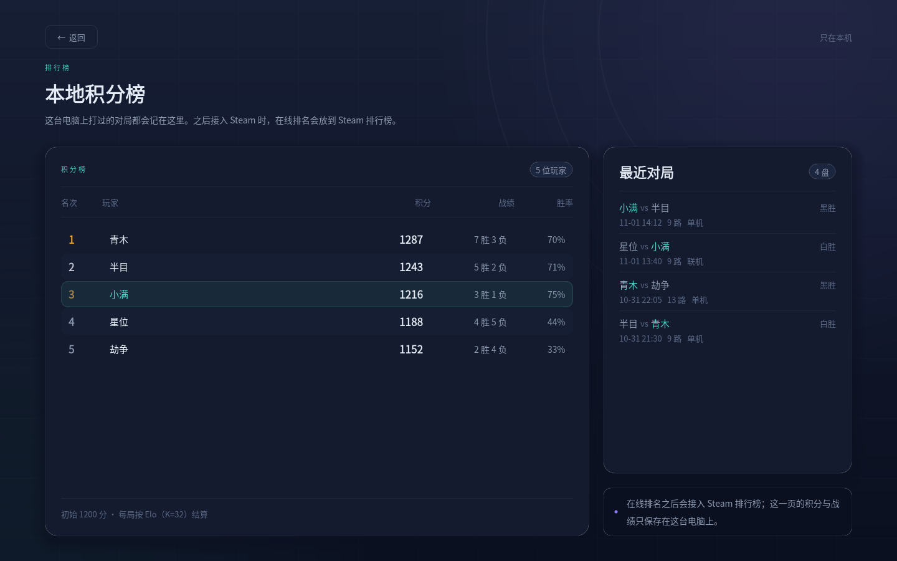<br>排行榜：本地 Elo、战绩、最近对局 | 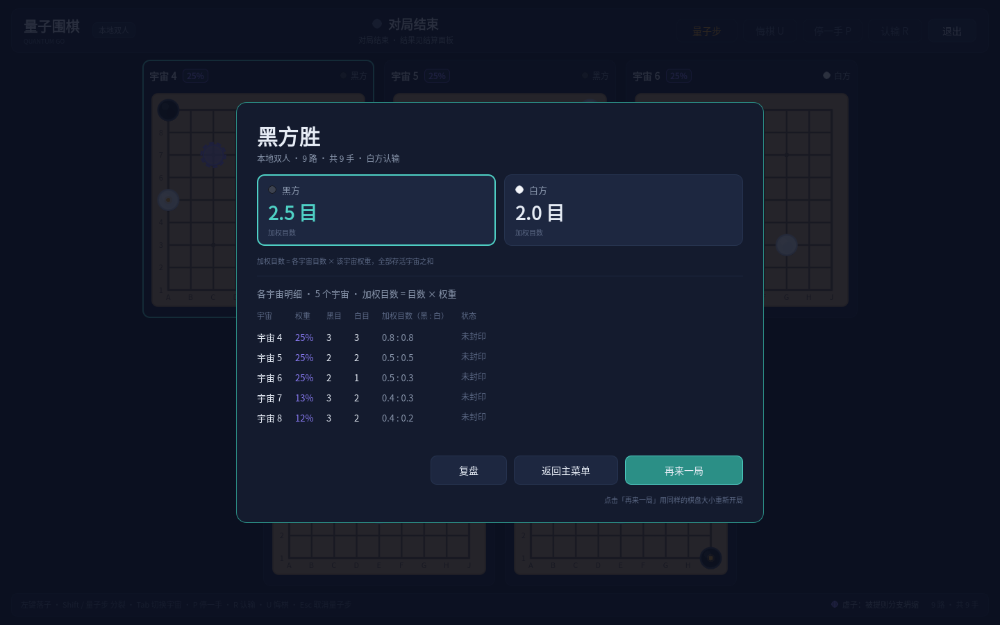<br>结算面板：各宇宙加权目数 |
| 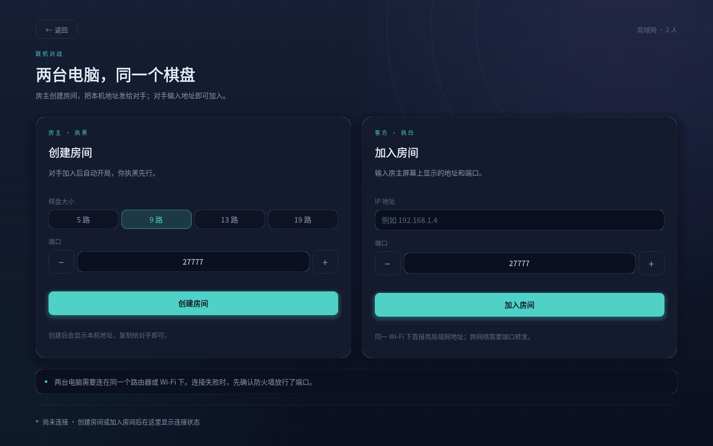<br>联机大厅：房主 / 加入 | <br>复盘：虚子与它对应的实子 |

## 运行

需要 **Godot 4.6.x 标准版**（不需要 .NET）。

```powershell
godot --path .                 # 编辑器
godot --path . --headless --quit-after 30   # 直接跑一遍真实入口
```

### 出包

`tools/build_windows.ps1 -Full` 会在 `build/windows/` 生成独立 exe，前提是本机装了
Godot 4.6.1 的导出模板（`编辑器 → 管理导出模板 → 下载`）。没有模板时可以先用
`tools/build_windows.ps1`（不带 `-Full`）出一个用编辑器二进制当运行时的临时包。

## 测试

```powershell
godot --headless --path . --script res://tests/run_tests.gd      # 规则引擎 215 + 编码 134
godot --headless --path . --script res://tests/run_session.gd    # 会话层 26
powershell -ExecutionPolicy Bypass -File tests/net/run_net_test.ps1   # 联机 4 场景
godot --headless --path . --script res://tests/ui_shell/smoke.gd # 主界面 98
godot --headless --path . --script res://tests/ui_board/smoke.gd # 对局界面 58
godot --path . --script res://tests/ui_board/click_smoke.gd      # 真实鼠标点击 12
godot --path . --script res://tests/ui_board/scoring_smoke.gd    # 结算阶段 13
godot --path . --script res://tests/ui_board/replay_smoke.gd     # 隐藏虚子 + 复盘 20
godot --path . --script res://tests/ui_tutorial/smoke.gd         # 教程 21 + 截图
godot --headless --path . --script res://tests/i18n/smoke.gd     # 中英切换 26
godot --headless --path . --script res://tests/platform/smoke.gd # 成就/排行榜触发点 21
```

联机测试会自己拉起两个 Godot 进程跑完整对局、中途杀进程、拒绝连接、端口占用四个场景。
界面截图脚本在 `tools/shot.gd`。

## 目录

```
src/core/      规则引擎：宇宙、虚子、观测、加权计分（纯数据，无节点、无 I/O）
src/game/      会话层（本地双人 / 房主 / 客户端）、设置、排行榜、平台接口、多语言
src/net/       ENet 传输与状态编码
src/ui/        界面：shell（菜单/联机/排行/规则/设置）、match（对局）、tutorial、replay
assets/        字体、图标、程序生成的音效与背景音乐
translations/  英文文案（中文是源码里的原文）
tests/         单元测试、联机集成、界面冒烟、教程与复盘端到端
tools/         打包、截图、图标与音频生成脚本（音频全部由 Python 合成）
docs/          规则、架构、截图，以及早期商业发行计划的留档
prototype/     最初的单文件 C 版本（Windows 控制台），留作纪念
```

## 技术要点

- **规则核心是纯数据**：`src/core` 不引 Godot 节点、不读写文件，整局状态可以
  `snapshot()` / `restore()`，联机时直接编码发给对端。
- **随机只有一处**：每局一个 `seed`，落子顺序、分裂掷硬币、观测判定全部由它驱动。
  双方拿到同一个种子，所以状态校验和复盘都是确定的。
- **不完全信息在表现层**：虚子标记一直存在，但对局界面不画；只有教程、结算和复盘
  会把 `reveal_phantoms` 打开。
- **资源全部自制**：音效、背景音乐、图标都由 `tools/*.py` 程序生成，没有第三方素材；
  字体是 OFL 授权的 Noto Sans SC。

## 多语言

中文是源码里的原文，英文放在 `translations/en.json`（`{中文: English}` 字典）。
Godot 会自动翻译控件文本，所以静态文案不用写 `tr()`；运行时拼接的句子用
`tr("模板 %d") % [...]`。加新语言只需要再加一个 `translations/<locale>.json`
并在 `src/game/qg_locale.gd` 里注册。测试时可以用 `QG_LANG=en` 强制语言。

## 许可

代码以**木兰宽松许可证 v2** 发布，见 [`LICENSE`](LICENSE)。
字体 Noto Sans SC 以 SIL Open Font License 1.1 发布，见
[`assets/fonts/OFL.txt`](assets/fonts/OFL.txt)。

`docs/SHIPPING.md` 与 `docs/STORE.md` 是之前考虑 Steam 商业发行时写的清单和文案，
项目转为开源后仅作留档。

## 致谢

最初的单文件 C 原型（`prototype/main.c`）用控制台字符画棋盘，验证了「分裂 / 坍缩 /
加权计分」这套规则能跑起来；现在这版是把它重写成 Godot 版本。
